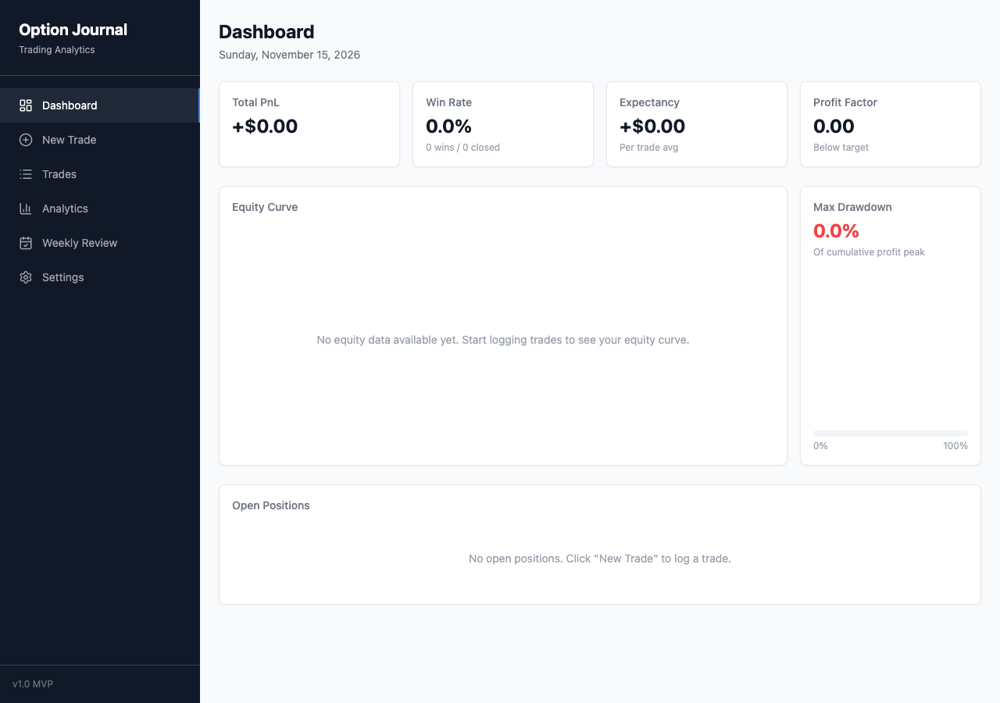
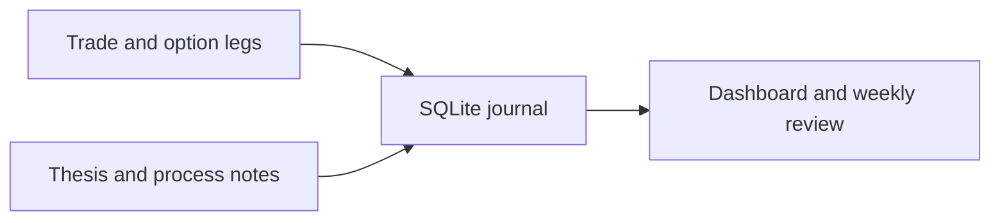

# Option Journal

**English** · [简体中文](README.zh-CN.md)

The trade ends. The useful questions should stay around.



A local options-trading journal built with Next.js, Prisma, and SQLite. It records trades and individual option legs, preserves thesis and process notes, and organizes dashboard statistics and weekly reviews.

## Keep the decision with the numbers

Record the underlying, strategy, direction, entry/exit, quantity, fees, option legs, and optional risk/context fields. Notes include thesis, rule compliance, emotion, market trend, VIX, and earnings context. Settings hold strategy templates and analysis buckets.

The weekly review is calculated from recorded trades by the repository's own calculation functions. No model API configuration is required for that route.

## Run locally

Clone the repository's default branch, then:

```bash
npm ci
npm run db:generate
npm run db:push
npm run dev -- --hostname 127.0.0.1
```

Open `http://127.0.0.1:3000`. The Prisma datasource is SQLite at `prisma/dev.db`. The application starts with an empty journal; create your first trade through **New Trade**.

For a production build, use `npm run build` and `npm start -- --hostname 127.0.0.1`. This local application has no account isolation in its data model; keep it on your own machine until appropriate access controls are provided.

## Explore the implementation

[Database schema](prisma/schema.prisma) · [Calculations](src/lib/calculations.ts) · [Strategy labels](src/lib/constants.ts)

Routes include the dashboard, trades, new-trade entry, trade details, weekly review, and settings. Example input is a multi-leg options trade plus its rationale; output is a saved journal record and calculated review. Metrics depend on complete, correctly entered records and the calculation conventions in the source.


