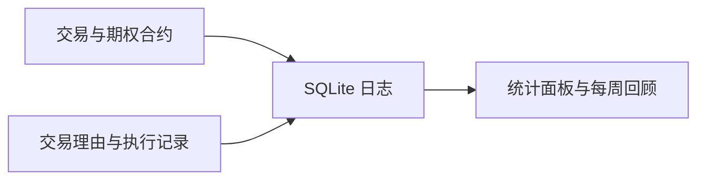

# Option Journal

[English](README.md) · **简体中文**

交易结束了，有价值的问题值得留下来。

一个使用 Next.js、Prisma 和 SQLite 的本地期权交易日志，记录交易与各个期权合约，把投资理由、执行过程和结果放在一起查看。

## 记录数字，也记录当时的想法

支持标的、策略、方向、开平仓时间与价格、数量、费用、合约明细，以及可选的风险和市场信息。还可记录交易理由、规则遵守情况、情绪、趋势、VIX、财报背景和后续笔记。

设置页面保存策略模板和分析分组。每周回顾由仓库内的计算函数生成，对应接口无需配置模型 API。

## 本地运行

克隆仓库默认分支后执行：

```bash
npm ci
npm run db:generate
npm run db:push
npm run dev -- --hostname 127.0.0.1
```

打开 `http://127.0.0.1:3000`。数据库使用 `prisma/dev.db`。可选命令 `npm run db:seed` 会写入仓库示例记录；已有数据时，需要阅读 `prisma/seed.ts` 后再决定使用。

构建使用 `npm run build`，启动使用 `npm start -- --hostname 127.0.0.1`。当前数据模型没有多用户账号隔离，应在自己的电脑使用；公开部署需要相应访问控制。

## 文件与使用示例

[数据库结构](prisma/schema.prisma) · [计算逻辑](src/lib/calculations.ts) · [策略名称](src/lib/constants.ts)

输入一次多合约期权交易与理由，保存后可在交易列表、详情、统计面板和每周回顾查看。统计结果取决于记录完整性与代码采用的计算口径。


